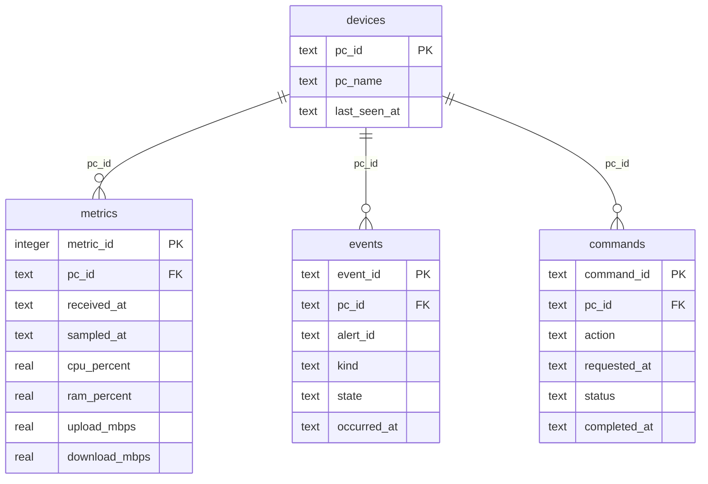

# 4주 차 이력·경고 연동 초안

C의 구현 및 샘플 응답에 적용한 제안이다. A와 ERD, 조회 규격, 경고 판정 및 보관 정책을 확정해야 한다.

## ERD와 화면 조회 필드



- 측정 그래프와 표는 `received_at`과 네 가지 측정값을 사용한다. 단위는 퍼센트와 Mbps이며 결측은 JSON `null`이다. `sampled_at`은 Agent 측정 시각을 보존하는 후보 필드다.
- 경고 표는 `occurred_at`, `kind`, `state`를 표시하고 `alert_id`는 같은 경고 구간을 식별하는 데 사용한다.
- `commands`는 감사 조회 후속 범위다. 기존 `command_audit`, `exam_events`와의 대응 및 마이그레이션은 A와 검토한다.
- 조회 인덱스는 `metrics(pc_id, received_at)`, `events(pc_id, occurred_at)`를 제안한다. PC가 현재 접속 목록에 없어도 저장된 PC ID로 조회 가능해야 한다.

## TLS 조회 제안

기존 TCP 프레이밍과 TLS 관리자 등록을 사용한다. 지원 서버는 `REGISTER_RESULT`에 `history_v1: true`를 보낸다. C는 조회 시점의 UTC 종료 시각을 고정하고 최근 10분 또는 1시간에 대해 `start_at <= 시각 < end_at`을 요청한다.

```json
{"type":"GET_HISTORY","version":1,"request_id":"request-1","pc_id":"PC-02","start_at":"2026-11-18T09:50:00Z","end_at":"2026-11-18T10:00:00Z"}
```

```json
{"type":"HISTORY_RESULT","version":1,"request_id":"request-1","pc_id":"PC-02","ok":true,"page":0,"done":true,"metrics":[{"received_at":"2026-11-18T09:59:58Z","cpu_percent":95,"ram_percent":55,"upload_mbps":0,"download_mbps":null}],"events":[{"occurred_at":"2026-11-18T09:59:58Z","alert_id":"cpu-pc02-1","kind":"CPU_HIGH","state":"raised"}]}
```

- 서버는 같은 요청의 페이지를 0부터 순서대로 전송하고 마지막 페이지에 `done: true`를 넣는다. 프레임은 기존 64 KiB 제한을 적용하고 한 페이지는 측정·경고 합계 최대 200행, 한 응답은 최대 64페이지로 제안한다. 각 PC의 측정 수신 시각은 행마다 고유해야 한다.
- 빈 결과는 `ok: true`, `done: true`와 빈 배열 두 개로 반환한다. 실패는 같은 요청 식별 필드와 `ok: false`, `code`를 반환한다. 오류 코드 목록, 최대 조회 범위, 보관 기간, 페이지 일관성은 A와 확정한다.
- C는 마지막 페이지까지 모은 결과만 화면에 적용한다. PC나 범위가 바뀌면 이전 결과를 버리고 새 조회 상태를 표시한다. 경고는 조회 범위 안에서 발생한 전환을 표시하며, 상시 경고 구독과 현재 활성 경고 목록은 별도 연동이 필요하다.

## 경고 발생·복귀 제안

- A가 `CPU_HIGH`, `RAM_HIGH`, `DEVICE_OFFLINE`의 발생(`raised`)과 정상 복귀(`resolved`)를 판정하고 저장한다. CPU·RAM 90% 10초 지속은 검토용 예시이며 실제 발생·복귀 임계치, 유지 시간, 오프라인 감지 시간은 합의 대상이다.
- 발생과 복귀는 같은 `alert_id`를 사용한다. 같은 구간에서 반복 수신한 발생 또는 복귀는 C가 PC·경고 종류·구간 ID·상태 기준으로 한 행만 표시한다. 복귀 후 다시 발생하면 A가 새 구간 ID를 부여한다.
- A와 검증할 항목은 동일 경고가 유지되는 동안 한 건만 저장되는지, 정상 복귀 후 재발이 새 경고로 잡히는지, 서버 재시작 후 저장된 이력과 열린 경고 구간을 조회할 수 있는지다.
