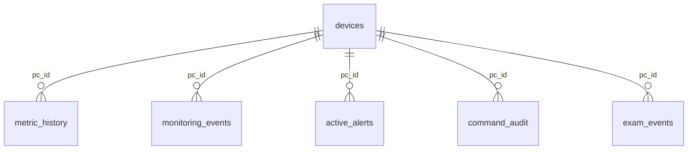

# A 4주차: 저장·이력·경고 (로컬 구현 초안)

## 범위와 상태

계획은 ① devices·metrics·events·commands 스키마/ERD 검토 ② SQLite 동시 접근 ③ PC·기간별 이력 조회 ④ 보관·크기 제한 및 오류 처리 ⑤ 오프라인·CPU/RAM 경고 기록 ⑥ C와 지속 시간·중복·복귀 기준 합의다. B는 연결 장애 시나리오, C는 이력·경고 UI를 담당한다.

4주차 이력·경고 변경은 2026-11-19 06:46 UTC EC2에 배포했다. TLS 이력 요청으로 PC-01/02/03의 실제 측정 기록 43/42/43건을 조회했다. 실제 C GUI, 서버 재시작 후 이력, 임계치 경고의 공동 검증은 아직 하지 않았다. C 커밋 8aa383d의 이력 클라이언트 제안에 서버를 맞추었으나 C와의 기준 합의는 아직 하지 않았다. B/C 소스를 직접 수정하지 않았다.

B 원격 커밋 65e7a6c의 Chrome 시험 탭·카메라·확장 감시 이벤트 세 종류를 A 서버에서 검증하고 기존 시험 이벤트 저장·중복 제거·구독 중계 경로에 연결해 운영 배포했다. 지원 플래그는 인증된 TLS 연결에서만 알린다. B 커밋은 통합 커밋 b6075db에 병합했다. 전원 제어도 운영 서버에 배포했으며 로컬 모의 테스트만 마쳤다. [상세](a-chrome-power-integration.md).

## 저장 구조

기존 `--audit-db` SQLite 파일에 `devices`, `metric_history`, `monitoring_events`, `active_alerts`를 추가한다. 측정과 이벤트는 PC ID, 서버 수신 시각(Unix 초), JSON을 저장하며 PC ID·시각 인덱스를 사용한다. 기존 시험 이벤트 `exam_events`와 명령 `command_audit`를 그대로 보존한다. 연결을 공유하는 스레드는 잠금과 트랜잭션으로 직렬화한다. 새 측정값과 그에 따른 경고 및 활성 상태는 같은 트랜잭션으로 기록된다. 기록은 30일을 기준으로 시작 시와 쓰기 중 최대 분당 한 번 정리한다. 기기 이름·최종 시각·온라인 여부도 저장하지만 현재 GUI의 접속 목록은 재시작 후 재접속한 기기만 표시한다. DB의 기기·활성 경고는 이력 정리 시 자동 삭제하지 않는다.

위 관계는 PC ID를 통한 논리적 관계다. 기존 감사 데이터를 보존하고 기기 등록 전의 과거 기록도 유지하기 위해 SQLite 외래 키 제약은 추가하지 않는다. C의 `metrics`·`events`·`commands` 제안은 각각 `metric_history`·`monitoring_events`·기존 `command_audit`에 대응하며 저장 열은 JSON을 포함한 별도 형태다.

## 이력 조회 제안

인증된 TLS 연결의 `REGISTER_RESULT`는 `history_v1: true`를 제공한다. C의 `GET_HISTORY` 버전 1 형식(`request_id`, `pc_id`, UTC 오프셋이 있는 `start_at`, `end_at`)을 받고 측정값·경고 전환을 `HISTORY_RESULT` 페이지로 반환한다. 시작은 포함하고 끝은 제외하며, 조회 범위는 최대 30일, 페이지당 최대 200행·프레임 64 KiB 미만, 요청당 최대 64페이지·12,800행이다. 프레임 크기에 따라 200행보다 일찍 페이지를 나누며 페이지 수가 64를 넘으면 응답을 시작하기 전에 실패한다. 초과 시 `HISTORY_TOO_LARGE`, 잘못된 입력은 `INVALID_REQUEST`, 저장소 오류는 `STORAGE_UNAVAILABLE`로 실패를 명시한다. 한 요청은 저장소 잠금 아래 읽은 스냅샷을 사용한다. 같은 PC의 측정 수신 시각이 겹치면 저장 시 마이크로초 단위로 구분한다. 기존 시험 이벤트·명령 감사는 이 API에 포함되지 않는다. 외부 서버는 기존 TLS·관리자 토큰 인증을 요구하며 로컬 무인증 개발 모드는 기존 동작을 따른다. 이전 A 초안의 `kind`·Unix 초 조회도 보존한다.

## 임시 경고 기준

서버 수신 기준으로 CPU 또는 RAM이 90% 이상인 샘플이 10초 이상 연속되고 샘플 간격이 6초 이내이면 `CPU_HIGH` 또는 `RAM_HIGH` 발생을 한 번 저장한다. 활성 경고는 85% 미만 샘플에서 같은 alert_id의 복귀를 저장한다. null이나 6초 초과 공백은 지속 시간 계산을 초기화하며 활성 경고를 자동 복구하지 않는다. 연결 종료 또는 서버 재시작 뒤에도 열린 CPU/RAM 경고를 보존하며 새 샘플이 85% 미만일 때 같은 ID로 복귀한다. 연결이 끊기면 `DEVICE_OFFLINE` 발생, 재접속하면 같은 ID의 복귀를 기록한다. 서버가 갑자기 중지됐을 때 실제 단절 시각은 알 수 없으므로 다음 서버 시작 시 이전 온라인 PC의 오프라인 발생을 기록한다. 복구 전에 실시간 상태를 정상으로 추정하지 않는다. A는 C가 제안한 이 기준에 동의하며 운영 환경의 실제 공동 검증이 남았다. 실시간 알림과 열린 경고 목록은 로컬에 구현했으나 운영에 배포하지 않았다. [구독 규격](a-alert-stream-contract.md).

로컬 테스트는 DB를 닫고 서버 상태를 다시 만들어 열린 CPU 경고·서버 재시작 시의 오프라인 구간을 복구한 뒤 같은 ID로 복귀하는지 확인한다. C의 변경 없는 이력 수집 코드로 다중 페이지를 읽는 테스트와 프레임 크기·DB 오류 테스트도 포함한다. 실제 운영 서버와 실제 GUI의 공동 검증은 아직 하지 않았다.

2026-11-19 로컬 검증: `python -m unittest tests.test_server_week4 tests.test_server_week3 tests.test_server_week2 tests.test_server_exam tests.test_server_exam_stream tests.test_server_foreground tests.test_protocol` 58개 통과. 동시 쓰기·트랜잭션 실패 롤백도 확인했다. 이는 운영 EC2 재시작이나 PC 세 대 실측 결과를 뜻하지 않는다.

DB 쓰기가 실패하면 해당 Agent 세션을 종료해 저장 실패를 조용히 성공으로 취급하지 않는다. 종료 이벤트 저장도 실패할 수 있으며 로그에 오류를 남긴다. DB 오류 중 모니터링 연속성 및 복구 정책은 추가 검토가 필요하다.

## 남은 협업 및 검증

- C: 이력 UI와 서버의 실제 TLS 연결 검증, ERD·임계치·지속 시간·복귀·연결 공백과 재시작 정책 합의 및 실시간 경고 연동.
- B 및 PC 소유자: 실제 Agent 연결 단절·복구와 실제 부하 시나리오에 참여. PC-02/03은 각 소유자가 조작한다.
- A: C 합의 반영, GUI와 실제 PC 공동 검증, DB 장애·용량·보관 정책 점검, 필요 시 운영 배포 및 재시작 후 검증. 서버 재시작 시에도 기존 파일·인증정보를 유지한다.
